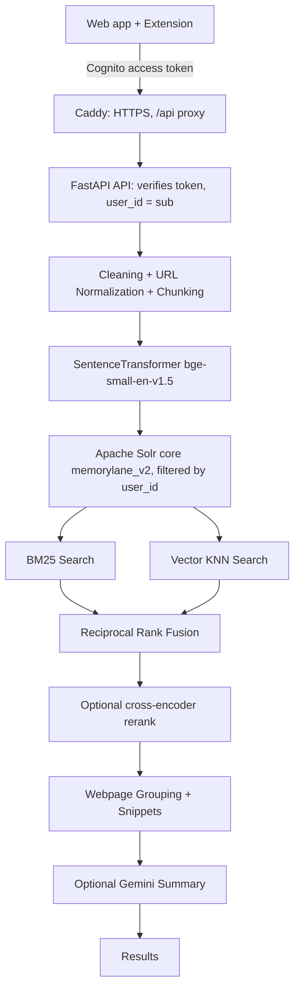

# MemoryLane

Personal browsing-memory retrieval: save pages you visit, then search them with hybrid BM25 + dense-vector ranking on Apache Solr 9.x. FastAPI serves indexing and search; Gemini is optional for summaries.

## 1. Overview

MemoryLane stores readable webpage text as overlapping-size chunks, embeds each chunk with `BAAI/bge-small-en-v1.5` by default (384 dimensions), and indexes both lexical fields and vectors in a Solr standalone core named `memorylane_v2`. Search fuses BM25 and KNN rankings with Reciprocal Rank Fusion, groups hits by webpage, and can summarize the winning page with Gemini.

## 2. Architecture



## 3. Prerequisites

- **Python 3.10+**
- **Apache Solr 9.x** (DenseVectorField is not available in Solr 8). Target version: **9.7.0**.
- Optional: **Google Gemini API key** for summaries
- Chrome/Chromium for the Manifest V3 extension
- Docker (optional) if you prefer Compose instead of a local Solr install

## 4. Installation

```bash
cd memorylane
python -m venv .venv
# Windows: .venv\Scripts\activate
# Unix:    source .venv/bin/activate
pip install -r requirements.txt
copy .env.example .env   # Windows
# cp .env.example .env   # Unix
```

The first embedding call downloads `all-MiniLM-L6-v2` from Hugging Face.

## 5. Configuration

Copy `.env.example` to `.env`. Variables:

| Variable | Default | Purpose |
|---|---|---|
| `SOLR_URL` | `http://localhost:8983/solr/memorylane_v2` | Core URL |
| `DEFAULT_TOP_K` | `5` | Grouped results to return |
| `DEFAULT_CANDIDATE_POOL` | `50` | BM25 and KNN candidate size |
| `RRF_K` | `60` | Reciprocal Rank Fusion constant |
| `BM25_WEIGHT` / `VECTOR_WEIGHT` | `1.0` / `1.0` | RRF weights |
| `PAGE_SECOND_CHUNK_WEIGHT` | `0.3` | Weight of a page's second-best chunk |
| `MIN_VECTOR_SIMILARITY` | `0.55` | Pages with no BM25 match need at least this cosine similarity |
| `MAP_MAX_PAGES` / `MAP_MIN_PAGES` | `2000` / `10` | Library map: most recent pages mapped; fewer than the minimum shows "save a few more" |
| `MAP_OUTLIER_SIMILARITY` / `MAP_CROSS_TOPIC_SIMILARITY` | `0.35` / `0.65` | Unclustered threshold; similarity for a dashed link between topics |
| `MAP_CACHE_USERS` / `MAP_CACHE_TTL_SECONDS` | `50` / `600` | In-memory map cache (per user, LRU) |
| `RERANK_ENABLED` / `RERANK_MODEL` / `RERANK_TOP_N` | `false` / `cross-encoder/ms-marco-MiniLM-L-6-v2` / `20` | Optional cross-encoder reranker |
| `CHUNK_MAX_WORDS` / `CHUNK_MIN_WORDS` / `CHUNK_OVERLAP_WORDS` | `150` / `40` / `30` | Chunk size, short-tail merge, overlap |
| `EMBEDDING_MODEL` | `BAAI/bge-small-en-v1.5` | SentenceTransformer name (`all-MiniLM-L6-v2` also works) |
| `EMBEDDING_DIM` | `384` | Must match Solr `DenseVectorField` |
| `EMBEDDING_QUERY_PREFIX` | BGE instruction for BGE models, else empty | Prepended to queries only |
| `COGNITO_REGION` / `COGNITO_USER_POOL_ID` / `COGNITO_APP_CLIENT_ID` | required | Cognito pool whose access tokens the API accepts; the API refuses to start without them |
| `CORS_ORIGINS` | `http://localhost:5173` | Comma-separated allowed origins |
| `GEMINI_API_KEY` | empty | Leave empty to disable summaries |
| `GEMINI_MODEL` | `gemini-2.0-flash` | Gemini model id |
| `API_HOST` / `API_PORT` | `0.0.0.0` / `8000` | Uvicorn bind |

## 6. Solr setup

Start Solr 9.x (local install or Docker). Then install the core (`CORE_NAME`, default `memorylane_v2`) and schema:

```bash
# Unix
CORE_NAME=memorylane_v2 ./scripts/setup_solr.sh

# Windows PowerShell
.\scripts\setup_solr.ps1

# Destructive recreate
./scripts/setup_solr.sh --reset
.\scripts\setup_solr.ps1 -Reset
```

The script is idempotent: it checks Solr is up, requires version 9+, creates the core if missing, applies the schema via the Schema API, reloads, then verifies ping, indexing, BM25 (including stemming), and KNN with a `user_id` filter.

`scripts/setup_solr.sh` is the single source of truth for the schema (`scripts/setup_solr.ps1` mirrors it). It applies these fields on top of Solr's `_default` configset: `id` (`{page_id}::{n}`), `user_id`, `page_id`, `url`, `domain`, `title` and `text` (`text_en`: stopwords and Porter stemming), `chunk_id`, `total_chunks`, `timestamp` (`pdate`), `content_hash`, `embedding_model`, and `embedding` (cosine 384-d, not stored).

To move pages from an old core into a new one (the source core is never modified):

```bash
python -m scripts.reindex --source-core memorylane --target-core memorylane_v2 --user-id legacy [--delete-user <id>] [--dry-run]
```

## 7. Running the API

From the project root (so `backend` is importable):

```bash
uvicorn backend.main:app --reload --host 0.0.0.0 --port 8000
```

Health:

```bash
curl http://localhost:8000/health
```

Returns Solr, embedding-model, and Gemini status. Overall `status` is `ok` when Solr and the embedding model are ready; Gemini is optional.

### Authentication and API

Every endpoint except `/health` needs `Authorization: Bearer <Cognito access token>`. The API verifies the RS256 signature against the pool's JWKS, plus `exp`, `iss`, `token_use == "access"` and `client_id`. The user id is the token's `sub`; no endpoint accepts a user id from the client, and every Solr read, write and delete is filtered by it. Behind Caddy the API is served under `/api`.

| Method & path | Purpose |
|---|---|
| `GET /health` | Public status |
| `POST /memory` | Save a page → `{status: saved\|unchanged\|skipped, message, page}`; 422 if too little text |
| `GET /memory/status?url=[&canonical_url=]` | `{saved, page?}` |
| `DELETE /memory/{page_id}` | 204, or 404 if not the caller's |
| `GET /memories?limit=20&offset=0` | `{total, pages}`, newest first |
| `POST /search` | `{query, num_results, summarize, debug}` → `{query, results}` |
| `POST /summarize` | `{query, id}` → `{id, summary}`; 404 if not the caller's |
| `GET /me/export` | JSON download of all the caller's pages |
| `DELETE /me/data` | 204; deletes all the caller's chunks |
| `GET /memory/{page_id}/related?k=5` | `{page_id, related: [{id, title, url, domain, saved_at, similarity}]}`; 404 if not the caller's |
| `GET /map` | `{status, version, topics, pages, edges, counts}` or `{status: "too_few", count}` |
| `GET /map/search?q=` | `{query, version, topics: [{id, label, score}], pages: [ids]}` |
| `POST /search` with `topic` | Searches only that map topic's pages; 409 if the map has changed |

## 8. Indexing (`POST /memory`)

Body: `{ "url", "title", "content", "html"?, "canonical_url"?, "is_manual" }`.

Pipeline (`backend/ingest.py`): canonical + normalized URL → `page_id = sha256(user_id|url)[:32]` → YouTube transcript, or `trafilatura` cleaning of `html` (falling back to `content`) → reject with 422 below 50 words → skip as `unchanged` if the content hash and embedding model match → sentence chunking → embed `title + chunk` → upsert `{page_id}::{n}` and delete stale higher-numbered chunks. Re-saving a changed page updates it with no duplicate chunks.

## 9. Search (`POST /search`)

Body: `{ "query", "num_results": 5, "summarize": false, "debug": false }`.

Uses the same hybrid pipeline as the CLI. Each result has a plain-text `snippet`. Set `debug` to include `bm25_rank`, `knn_rank`, `fused_score` and per-stage `timings`.

## 10. Hybrid retrieval and fusion

1. BM25 on `title^2 text` with phrase boost `pf=text^2 title^3` (edismax, field queries disabled), concurrently with query embedding (cached) → Solr `{!knn f=embedding topK=...}`
2. Reciprocal Rank Fusion: `w_bm25 / (k + rank_bm25) + w_knn / (k + rank_knn)`; a chunk missing from one list gets nothing from it
3. Optional cross-encoder rerank of the top `RERANK_TOP_N` chunks
4. Group by `page_id`: best chunk + `PAGE_SECOND_CHUNK_WEIGHT` × second-best chunk
5. Relevance floor: drop pages with no BM25 match whose best chunk has cosine similarity below `MIN_VECTOR_SIMILARITY` (Solr's KNN score is `(1 + cos) / 2`; debug output shows `vector_similarity`)
6. Snippet (`backend/snippets.py`): 2–3 consecutive readable sentences (8+ words, 70%+ letters, no `|`, ending in punctuation) around the sentence matching the most query terms, ties broken by embedding similarity; 200–280 characters; else the page's stored `description`; else none
7. Return the top-K pages with their snippets

## 10b. Library map and related pages

Every page stores a page vector (`page_embedding`, the normalised mean of its chunk vectors) on chunk 0. `backend/library_map.py` builds the map on request and caches it per user (invalidated on save and delete):

1. Fetch the user's most recent `MAP_MAX_PAGES` page vectors (cursorMark).
2. Project to ~50 dimensions (PCA) and normalise (cosine). k-means for k in [clamp(round(sqrt(n)/2), 3, 10), min(14, n/8)], chosen by silhouette score with a fixed seed. Any topic holding more than 25% of the pages (and more than 30) is split in two, repeatedly. 278 SciFact abstracts give 9 topics.
3. Pages below `MAP_OUTLIER_SIMILARITY` to their topic centre are unclustered, and so is a "topic" whose pages don't hang together (mean pairwise similarity below the threshold squared).
4. Labels: one Gemini call that sees every topic's titles, a keyword hint and the labels already in use, asked for distinct, specific 1-3 word labels; generic or duplicate answers are rejected. Fallback: c-TF-IDF over unigrams and bigrams from titles and descriptions (generic and title-filler words removed), as distinct Title Case labels. Every fallback is logged at WARNING. Labels are cached per topic membership.
5. Layout in a 0..1 box (drawn into a 1400 x 900 world): ellipse area proportional to page count, all ellipses covering ~30% of the box; topics packed into centred rows whose shape matches the canvas (ordered by a PCA of the centroids), then relaxed by a few rounds of repulsion and centre pull, with each label's space reserved so it never sits on another oval. Pages are placed by a local PCA inside their ellipse; unclustered pages sit between the topics they are closest to.
6. Links: each page to its 2 nearest neighbours in its topic (`edges`), and related topics (centroid similarity above `MAP_CROSS_TOPIC_SIMILARITY`, at most 2 per topic) in `topic_links`.

The canvas draws page links only for the hovered or selected topic and the selected page, topic links oval to oval, and dims dots in libraries over 150 pages until you zoom in past 1.6x. Building the map for 2,000 pages takes ~0.2 s on a laptop.

Related pages are a KNN over page vectors, pre-filtered to the user's other pages. `scripts/backfill_page_vectors.py` gives older pages their vector.

## 11. URL normalization

Lowercase scheme/host, strip `www.`, drop fragments, drop trailing slashes (except `/`), strip `utm_*`, `fbclid`, `gclid`, `ref`, `ref_src`, sort remaining query params. `page_id` is the first 32 hex characters of `sha256("{user_id}|{normalized_url}")`.

## 12. Chunking and embeddings

Text splits into paragraphs, then sentences, packed into chunks of at most 150 words. Each chunk starts with about 30 words of trailing sentences from the previous one. Over-long sentences are hard-split; a final chunk under 40 new words merges into the previous chunk. Passages are embedded as `title + chunk` in batches of 32; queries get `EMBEDDING_QUERY_PREFIX`. Embeddings are L2-normalized 384-d vectors; dimension mismatches raise an error.

## 13. Gemini summarization

If `GEMINI_API_KEY` is set, search asks Gemini to summarize **only** the stored page text. Query wording selects SHORT (`brief`, `tl;dr`, …), LONG (`detailed`, `in-depth`, …), or MEDIUM. Failures return `summary: null` without breaking search.

## 14. CLI

```bash
python -m backend.cli "your query" --user-id <cognito-sub> --top-k 5 --candidates 50 --debug --no-summarize
```

## 15. Browser extension

Load unpacked from `extension/` in `chrome://extensions` (Developer mode). The extension ID is pinned to `igdbkkmpnplmboeccgigbjgoefecdhck` by the `key` in `manifest.json`.

The popup is capture-only: sign in, **Remember this page**, undo, and an optional auto-capture with excluded sites. Searching opens the website. Endpoints live in `extension/config.js`. See `extension/README.md`.

## 16. Evaluation

Evaluation runs in-process (`ingest_page` + `hybrid_search`) under the user id `eval`, in a separate core (`--core`, default `memorylane_eval`), so benchmark data never mixes with real users.

```bash
CORE_NAME=memorylane_eval ./scripts/setup_solr.sh
python -m evaluation.scifact_ingest      # index the SciFact corpus
python -m evaluation.scifact_evaluate    # hybrid vs BM25-only vs vector-only: MRR, Recall, nDCG @10
python -m evaluation.generate_eval       # build queries from indexed pages
python -m evaluation.evaluate            # Recall@1/3/5/10 and MRR
```

Metrics use the production `hybrid_search` path. Relevant URLs are compared after normalization.

## 17. Tests

```bash
pytest tests/ -v
```

Unit tests cover URL ids, chunking edge cases, score fusion/grouping, and API contracts (including Gemini-off summaries). They do not require a live Solr instance.

## 18. Deployment (Docker Compose + Caddy)

`docker-compose.yml` runs Solr 9.7 (localhost only), the FastAPI backend (`backend/Dockerfile`, no published port) and Caddy (`deploy/caddy/`), which gets HTTPS certificates, serves the built frontend and proxies `/api/*` to the backend. Step-by-step instructions, including moving from the old setup without losing the old core, are in [`deploy/README.md`](deploy/README.md).

```bash
cp .env.example .env              # fill in
docker compose up -d solr
docker compose exec solr solr create -c memorylane_v2 -d _default
CORE_NAME=memorylane_v2 bash scripts/setup_solr.sh
docker compose up -d --build
```

---

### Manual verification

1. Start Solr 9.x → `setup_solr.ps1` / `setup_solr.sh` → core healthy
2. Start FastAPI → `GET /health`
3. `POST /memory` → documents in Solr
4. `POST /search` → hybrid results
5. Re-index the same URL → chunk count stable, no duplicates
6. Semantic query using different wording than the page
7. Gemini key set → summaries present
8. Load the extension → sign in → save a page → find it on the website
