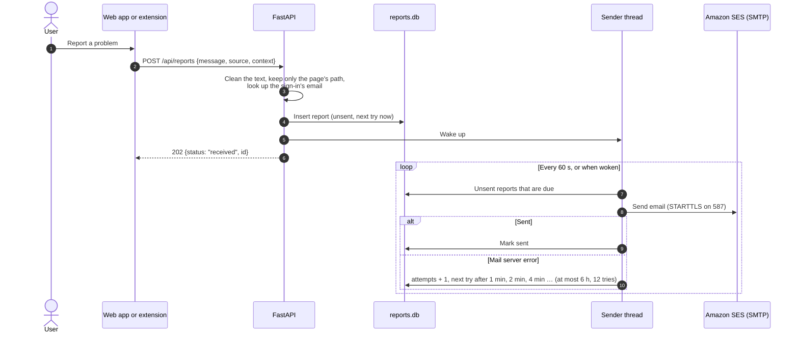

# API Endpoints

Paths are relative to the API base (`https://memorylane.site/api` on the live site). All endpoints except `/health` need a bearer token. The rate limit is per user.

## `GET /health`

Public. Reports whether the backend's dependencies are ready.

```json
{ "status": "ok", "solr": true, "embedding_model": true, "gemini": true }
```

`status` is `ok` when Solr and the embedding model are ready. `gemini: false` only means summaries are off.

---

## `POST /memory`

Save a page, or update it if it's already saved. Rate limit: 60/minute.

```json
{
  "url": "https://example.com/article",
  "title": "Example Article",
  "content": "Visible text of the page...",
  "html": "<!doctype html>...",
  "canonical_url": "https://example.com/article",
  "is_manual": true
}
```

`html` and `canonical_url` are optional. When `html` is present, the main text is extracted from it; `content` is the fallback.

For a YouTube video, the extension also sends `youtube`, which it fetched from YouTube in the browser (YouTube blocks the server). All its fields are optional:

```json
"youtube": {
  "transcript": "so today we ride through...",   // ≤ 500,000 characters
  "language": "en",
  "title": "Riding Through Japan",               // ≤ 500
  "channel": "Ajay Pandey",                      // ≤ 200
  "description": "A weekend ride...",            // ≤ 10,000
  "duration_seconds": 1402
}
```

The video is then saved from these (a video without a transcript, from its description). Without `youtube`, the server fetches the transcript itself, which fails on cloud servers.

```json
{
  "status": "saved",
  "message": "Memory stored successfully",
  "page": {
    "id": "3f9c...", "url": "https://example.com/article", "title": "Example Article",
    "domain": "example.com", "timestamp": "2026-10-22T09:30:00Z", "chunks": 4
  }
}
```

`status` is `saved`, `unchanged` (same text as before, or an automatic save of a page that's already saved: only a manual save updates a saved page) or `skipped` (e.g. a YouTube video that can't be saved). An address that isn't `http` or `https` (such as `javascript:` or `file:`) gets `400`. A page with fewer than 50 words gets `422`. Titles over 500 characters are shortened. A new page once the account has `MAX_PAGES_PER_USER` pages (5,000 by default) gets `403`; saved pages still update.

The canonical URL is used only when it's on the same site and isn't a parent of the page. Single-page apps such as Reddit keep the first page's canonical while the address changes, so the extension also drops a canonical that doesn't describe the current page (see [Capturing Web Content](../how-it-works/ingestion.md)).

---

## `GET /memory/status?url=...&canonical_url=...`

Whether you've saved this URL, normalised the same way as a save. Rate limit: 120/minute.

```json
{ "saved": true, "page": { "id": "3f9c...", "url": "...", "title": "...", "domain": "...", "timestamp": "..." } }
```

---

## `DELETE /memory/{page_id}`

Delete one of your pages. Returns `204`, or `404` if it isn't yours. The delete is soft-committed, so the very next list or search no longer shows the page. Rate limit: 60/minute.

---

## `POST /memory/existing`

Which of up to 50 page ids are still in your library. The extension uses it to drop pages you deleted on the website from its **Auto-saved today** list. Ids that aren't yours, or aren't page ids, are left out. Rate limit: 120/minute.

```json
{ "ids": ["3f9c...", "a1b2..."] }
```

The response has the same shape, listing only the ids that still exist.

---

## `GET /memory/{page_id}/related?k=5`

Your other pages closest in meaning to this one (`k` from 1 to 20). Rate limit: 120/minute.

```json
{
  "page_id": "3f9c...",
  "related": [
    { "id": "a1b2...", "title": "...", "url": "...", "domain": "...", "saved_at": "...", "similarity": 0.81 }
  ]
}
```

---

## `GET /memories?limit=20&offset=0`

Your pages, newest first (`limit` up to 100). Rate limit: 60/minute.

```json
{ "total": 278, "pages": [ { "id": "...", "url": "...", "title": "...", "domain": "...", "timestamp": "...", "chunks": 3 } ] }
```

---

## `POST /search`

Hybrid search over your pages. Rate limit: 60/minute.

```json
{
  "query": "documentation about ROS navigation",
  "num_results": 10,
  "summarize": false,
  "debug": false
}
```

| Field | Notes |
| --- | --- |
| `query` | Required, up to 500 characters |
| `num_results` | 1–20, default 10 |
| `summarize` | Also summarise each result with Gemini (slow; the web app uses `/summarize` per result instead) |
| `debug` | Add ranks, scores and timings |

```json
{
  "query": "documentation about ROS navigation",
  "results": [
    {
      "rank": 1, "id": "3f9c...", "title": "Nav2 Documentation", "url": "...",
      "domain": "docs.nav2.org", "timestamp": "...",
      "snippet": "Nav2 is the professionally supported successor of the ROS Navigation Stack...",
      "summary": null
    }
  ]
}
```

With `debug: true`, each result also has `bm25_rank`, `knn_rank`, `fused_score`, `rerank_score` and `vector_similarity`, and the response has `timings` in milliseconds.

---

## `POST /summarize`

Summarise one of your pages with Gemini. Rate limit: 20/minute.

```json
{ "query": "brief overview", "id": "3f9c..." }
```

```json
{ "id": "3f9c...", "summary": "..." }
```

`404` if the page isn't yours, `503` if Gemini isn't configured, `502` if it failed.

---

## `DELETE /me/data`

Deletes all your pages and the problem reports you sent. Returns `204`. Rate limit: 5/minute.

---

## `POST /reports`

Report a problem. The report is written to the server's database before the reply, then emailed to the maintainer in the background (retried with backoff if the mail server is down, also after a restart). Returns `202`. Rate limit: 5/hour.

```json
{
  "message": "Search shows Nintendo for 'greatest football player'",
  "source": "web",
  "context": { "app_version": "1.0.0", "page": "/search", "user_agent": "Mozilla/5.0 ...", "last_error": "" }
}
```

- `message`: 1–4,000 characters. `source`: `web` or `extension`.
- `context.page` is a path only; a query string (search terms) or anything that isn't a path is dropped.
- The reply-to address comes from the server's record of your sign-in, never from the request.

```json
{ "status": "received", "id": 42 }
```



Because the report is in the database before the reply, a restart or an email outage doesn't lose it.
