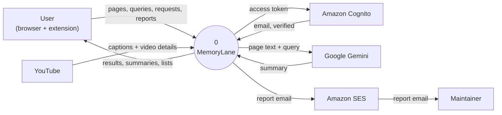
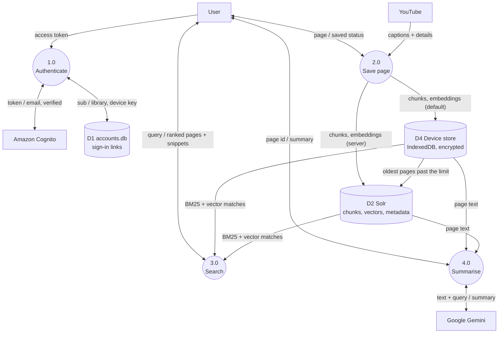
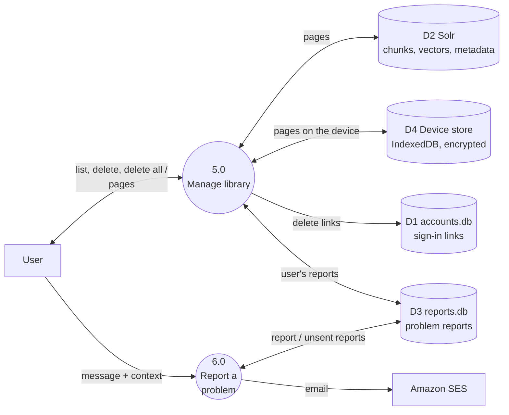

# Data Flow Diagrams

These diagrams show what data moves between MemoryLane and the outside world, and between its main processes. Processes are circles, data stores are cylinders, and external entities are rectangles.

## Level 0: context diagram

The whole system as one process, with everything it exchanges data with.

The user signs in with Amazon Cognito directly, and sends its access token with every request; that exchange is between two external entities, so it isn't drawn here (see [Security](security.md#sign-in-and-the-first-request)).

YouTube data is fetched by the extension inside the user's YouTube tab, so it reaches the server as part of the save request. The server contacts YouTube itself only when an older extension sent nothing.

## Level 1: main processes

Level 1 opens the system into six processes and four data stores (D4 is the encrypted store in the browser, for pages kept on the device). It's drawn in two halves so the lines stay readable. A two-headed arrow is a request and its answer, labelled *request / answer*.

### Saving and finding pages

### Library, account and reports

Processes 2.0 to 6.0 all get the `user_id` from 1.0 Authenticate; those arrows are left out to keep the diagrams readable.

| Process | Code | What it does |
| --- | --- | --- |
| 1.0 Authenticate | `backend/auth.py`, `backend/accounts.py` | Verifies the token; maps the sign-in to its library, linking Google and email sign-ins with the same verified email |
| 2.0 Save page | `extension/background.js`, `backend/ingest.py` (also run in the extension by `extension/engine/`) | Captures the page (or a video's captions), cleans, chunks, embeds and stores it: on the device (D4) by default, or on the server (D2) |
| 3.0 Search | `backend/retrieval.py`, `backend/query_intent.py`, `backend/snippets.py`; `extension/engine/retrieval.js` for D4 | Hybrid BM25 + vector search, fusion, relevance floor, snippets; the website fuses device and server results |
| 4.0 Summarise | `backend/summarizer.py` | Sends one page's stored text to Gemini |
| 5.0 Manage library | `backend/main.py` | Lists pages, deletes one, and deletes everything |
| 6.0 Report a problem | `backend/reports.py` | Stores the report, then emails it in the background with retries |

Every process gets the `user_id` from 1.0, and every read or write of D2 is filtered by it (see [Security](security.md)).
