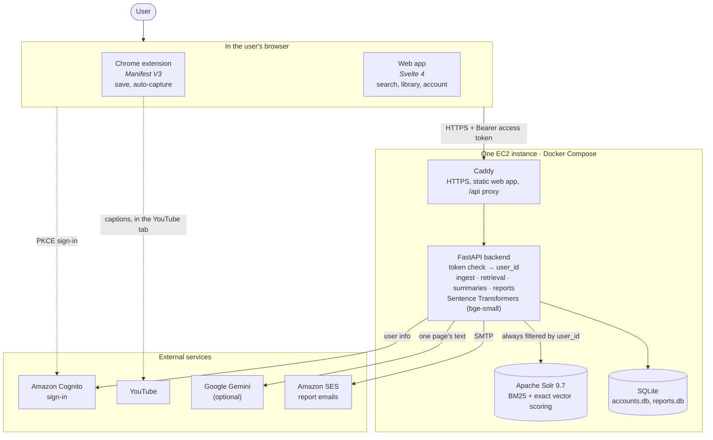

# System Architecture

The parts of MemoryLane and what they talk to, in the style of a C4 container diagram:

All the server pieces run with Docker Compose on one EC2 instance. Only Caddy is reachable from the internet. The [data flow diagrams](data-flow.md) show what data moves along each of these lines.

## Components

### Chrome extension

The collection layer. It saves the current page on request, runs optional auto-capture with its eligibility rules and excluded sites, and signs in with Cognito through `chrome.identity`. It doesn't search; searching happens on the website.

### Svelte web app

The search interface: home with recent pages, results with snippets and summaries, the library, the extension page, privacy and the account menu. It is built into static files that Caddy serves.

### Amazon Cognito

Hosts sign-in (Google, or email and password) and issues access tokens. The web app and extension both use the authorization-code flow with PKCE and a public client.

### Caddy

Gets and renews HTTPS certificates, serves the web app with a strict Content Security Policy, serves the extension zip, proxies `/api/*` to the backend, and redirects `www.memorylane.site` to `memorylane.site`.

### FastAPI backend

The application layer. It verifies every request's token, then saves pages, searches, finds related pages and asks Gemini for summaries, all scoped to the token's user. It loads the embedding model once at start-up.

### Apache Solr

Stores chunks, page vectors and metadata, and runs BM25 and KNN search. It is bound to localhost on the server.

### Gemini

Optional. Summarises a single page on request. Without a key, summaries are turned off and everything else works.

### Amazon SES

Sends problem reports to the maintainer by email over SMTP. Reports are stored in SQLite first, so nothing is lost if email is down; without SMTP settings they are only stored.

## Design principles

- **The server owns identity.** User ids come only from verified tokens.
- **One ingest path.** The API, scripts and evaluation all save pages through `ingest_page`, so they behave identically.
- **Search is page-level.** Retrieval works on chunks, but users see pages.
- **Optional parts stay optional.** Gemini and the reranker can be off without breaking search.

## Pages on the device

The extension also contains a complete search engine for pages kept in the browser (`extension/engine/`): the server's saving code in Pyodide, the same model in transformers.js, BM25 and vector search that score exactly as Solr, and encrypted IndexedDB storage. It runs in an offscreen document; the website reaches it through site-to-extension messaging. See [Pages on Your Device](../how-it-works/local-search.md) and ADRs [0012](../decisions/0012-local-first-storage.md)–[0016](../decisions/0016-encrypt-local-pages-and-backups.md).
