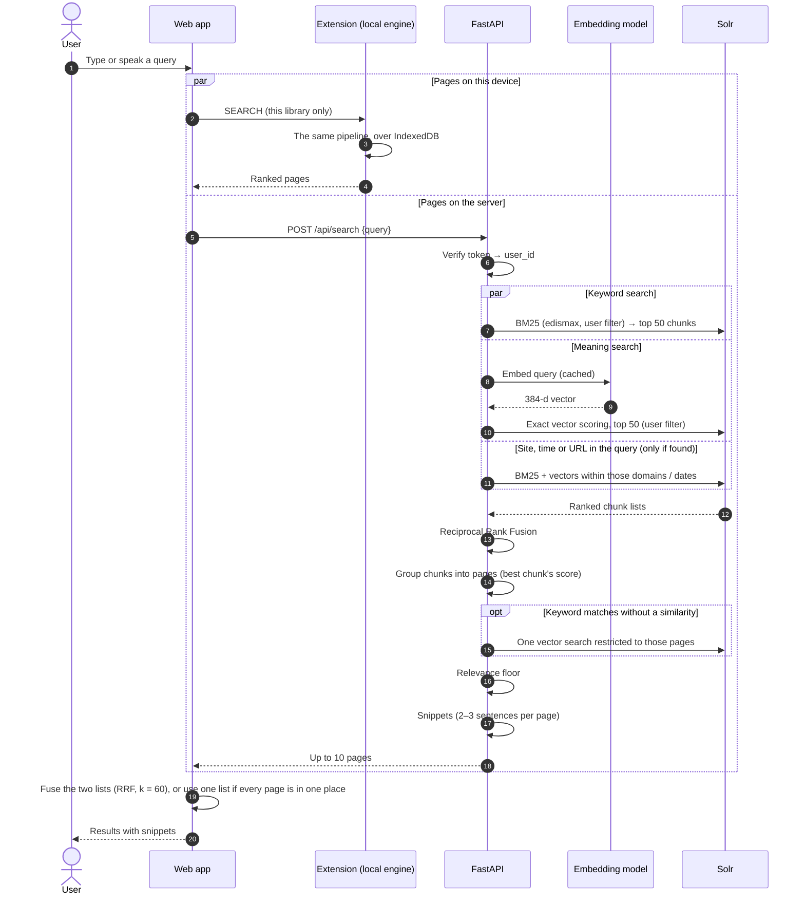

# Retrieval Architecture

Search combines two complementary retrievers:

1. **Lexical (BM25)** finds pages that use the query's words, including exact names, codes and jargon.
2. **Semantic (vector KNN)** finds pages about the same idea, even in different words.

Both run over chunks and are restricted to the signed-in user's pages. If the query names a site, a time or a URL, the same two searches also run over just the pages it points at. All rankings are fused, grouped into pages, filtered for relevance, and given snippets.

```text
Query
  ├─▶ BM25 (edismax on title^2 text)          ─┐
  ├─▶ embed query → KNN on chunk embeddings   ─┤  top 50 chunks each, user-filtered
  └─▶ site / time / URL in the query?         ─┤  if so: BM25 on the rest of the query
                                               │  + KNN (same vector), within those pages
                                               ▼
                         Reciprocal Rank Fusion
                                               ▼
                       (optional) cross-encoder rerank
                                               ▼
                        Group chunks by page_id
                                               ▼
                           Relevance floor
                                               ▼
                       Snippets → top-K pages
```

The BM25 query and the query embedding run concurrently.

### One search, step by step



## Lexical retrieval

Solr's **edismax** parser searches `title^2 text`, with a phrase boost `pf=text^2 title^3` so pages containing the query as a phrase rank higher. Both fields use `text_en` (possessives, stopwords, Porter stemming), so *learning* matches *learn*. Field queries in user input are disabled (`uf=-*`).

## Semantic retrieval

The query is embedded with `BAAI/bge-small-en-v1.5` (with BGE's search instruction in front) into the same 384-dimensional space as the chunks. Solr scores every one of the user's chunks by cosine (`{!func}vectorSimilarity(...)`, the same `(1 + cos) / 2` score as `{!knn}`) and returns the 50 nearest, all the user's own. The search is **exact**: Solr's HNSW `{!knn}` is approximate and missed a true neighbour in most SciFact queries, and the browser engine, which scans exactly, must return the same pages ([ADR 0013](../decisions/0013-exact-vector-search.md)). The extension runs this same pipeline on pages kept on the device ([Pages on Your Device](../how-it-works/local-search.md)).

## Site, time and URL in the query

`backend/query_intent.py` reads the parts of a query that say where or when a page was seen:

- **Site words.** Each of the user's domains gets names: its labels without the ending and generic parts (`www`, `docs`, `en`, `m`, ...), with hyphens removed. So `en.wikipedia.org` is *wikipedia*, `docs.nvidia.com` and `nvidia.com` are both *nvidia*, `rotten-tomatoes.com` is *rottentomatoes*. A query word, or two or three words run together ("rotten tomatoes"), that matches a name points at those domains. A few nicknames are known (*wiki*, *yt*, *gh*, *twitter*). Single words under 3 letters never count. The domain list comes from one facet query and is cached per user for 5 minutes, and dropped when they save or delete a page.
- **Time phrases**, in UTC: today, yesterday, *N* days/weeks/months/years ago, this/last/past week/month/year, recently or lately (2 weeks), a date (`31 august`, `aug 31st`, `on the 3rd of may 2025`, with a day's slack either side), a month after *in*, *from*, *during*, *last* (`in march`; a bare month name could be a topic, such as "march madness"), and a year after *from* or alongside a word like *saved* or *read*. A month or date without a year is the latest one not in the future.
- **A URL or domain** as the whole query.

When it finds one, the rest of the query (without the site, time and filler words like *page*, *article*, *saved*) runs through BM25 again, and the query's vector through KNN again (reused, so there is no second embedding), both filtered to those domains and that time range. Those two lists join the fusion below with the same weights as the main ones (`INTENT_WEIGHT` scales them). If nothing is left of the query ("what I read yesterday"), the matching pages are listed instead, nearest the named day first or newest first, and that list counts as both main lists together, twice over. A URL query also puts that saved page far ahead.

These are boosts, not filters: a page the main searches rank highly still competes. Pages from the site or time lists that matched the rest of the query by keyword, or where nothing was left, pass the relevance floor. Queries without a site, time or URL make no extra searches. Ones with them make two or three more Solr requests, alongside the main ones: about 6 ms more at the median in local tests. `QUERY_INTENT_ENABLED=false` turns this off.

## Reciprocal Rank Fusion

BM25 scores and cosine similarities are on different scales, so MemoryLane fuses **ranks**, not scores. For a chunk \(d\):

\[
\mathrm{RRF}(d) =
\frac{w_{\mathrm{bm25}}}{k + r_{\mathrm{bm25}}(d)}
+
\frac{w_{\mathrm{knn}}}{k + r_{\mathrm{knn}}(d)}
\]

with \(k = 60\) and both weights 1.0. A chunk missing from one list gets nothing from it. Chunks found by both retrievers rise to the top. The site and time lists add terms of the same form.

!!! note "Earlier versions"
    The first version min-max normalised the two score lists and averaged them (0.5 / 0.5). Min-max depends on the highest and lowest score in each list, so a single outlier changes every other score. RRF uses only ranks and has no such dependence.

## Optional reranking

With `RERANK_ENABLED=true`, the top 20 fused chunks are re-scored by a cross-encoder (`cross-encoder/ms-marco-MiniLM-L-6-v2`) that reads the query and chunk together. It is off on the live site to save memory.

## Page-level grouping

Users see pages, not chunks. Chunks are grouped by `page_id`, and each page scores:

\[
S_{\mathrm{page}} = s_{\mathrm{best}} + w \cdot s_{\mathrm{second}}, \qquad w = \texttt{PAGE\_SECOND\_CHUNK\_WEIGHT} = 0
\]

so a page is ranked by its best-matching passage. Until November 2026 \(w\) was 0.3, so that a page with two good passages would beat a page with one. With Reciprocal Rank Fusion, though, neighbouring ranks score almost the same (1/61 against 1/62), so the bonus outweighed them and longer pages beat better matches. On SciFact, setting \(w\) to 0 raised MRR@10 from 0.60 to 0.79 (see [Results](../evaluation/results.md#scoring-a-page-by-its-best-chunk)).

## Relevance floor

KNN always returns 50 neighbours, however unrelated. A page with **no** BM25 match is dropped unless its best chunk's cosine similarity is at least `MIN_VECTOR_SIMILARITY` (0.55). Solr reports KNN scores as \((1 + \cos)/2\), so the backend converts them first. Pages a site or time in the query points at, and that matched the rest of it by keyword, are kept.

Keyword matches are judged too, because BM25 accepts a page that shares any one word with the query. A page whose title and best chunk hold at least `KEYWORD_FULL_MATCH` (75%) of the query's words (as the snippet code counts them: 3+ letters, common words left out, prefix match) is kept whatever its similarity, so exact names, error codes and rare words are never lost. A page that shares only some of them needs `MIN_VECTOR_SIMILARITY`, like a page that shares none. For "greatest football player of all time", Nintendo ("the greatest games of all time", best chunk similarity 0.51) and Video game ("the player ... a later time", 0.46) match two of the four words and are about something else, so they're dropped; Lionel Messi holds all four (0.69). Measured with `bge-small-en-v1.5` on the real Wikipedia articles.

When such a page's chunks weren't in the main KNN list, its similarity is looked up with one more KNN request restricted to those pages (at most 50 pages, 8 chunks each). If that request fails, they're dropped rather than shown unjudged.

The words counted here leave out ones that only say what kind of thing was read (*article*, *page*, *post*, *site*, *video*, *thread*, *link*, *blog*, unless the query has nothing else), and a plural ending is dropped, so *vitamins* matches *vitamin*.

A fixed floor alone is not enough: `bge-small-en-v1.5` scores almost every page between 0.55 and 0.85, so loosely related pages clear 0.55 easily. A page kept for its similarity (no keyword match, or only some of the words) must therefore also reach `RELATIVE_SIMILARITY` (0.7) of the way from `MIN_VECTOR_SIMILARITY` up to the best similarity among the query's candidates. For "article about vitamins" over 100 mixed pages, the NHS vitamin D page scores 0.72, so the bar is \(0.55 + 0.7 \times (0.72 - 0.55) = 0.67\): Marathon (0.66), Obesity (0.64) and Stoicism (0.62) go, and 10 results become the 3 pages that mention vitamins. Over 22 labelled queries on those pages, it cut the results that weren't about the query from 110 to 19, and SciFact improved slightly (MRR@10 0.785 to 0.787, Hit@10 0.92 to 0.93).

## Snippets

For each result, `backend/snippets.py` picks 2–3 consecutive readable sentences around the sentence that contains the most query terms (the first one on a tie). If no sentence contains a query term, the first 3 readable sentences are compared with the query by embedding, so the snippet still fits a search by meaning. Embedding runs on the server's CPU during the search, which is why it's limited to this case. A readable sentence has 8+ words, is at least 70% letters, has no table pipes and ends in punctuation. Snippets are 200–280 characters. If no sentence qualifies, the page's stored description is used.

## Debugging

`"debug": true` adds each page's `bm25_rank`, `knn_rank`, `fused_score`, `vector_similarity` and per-stage `timings` (including `intent_ms`) to the response. The CLI prints the same with `--debug`.
