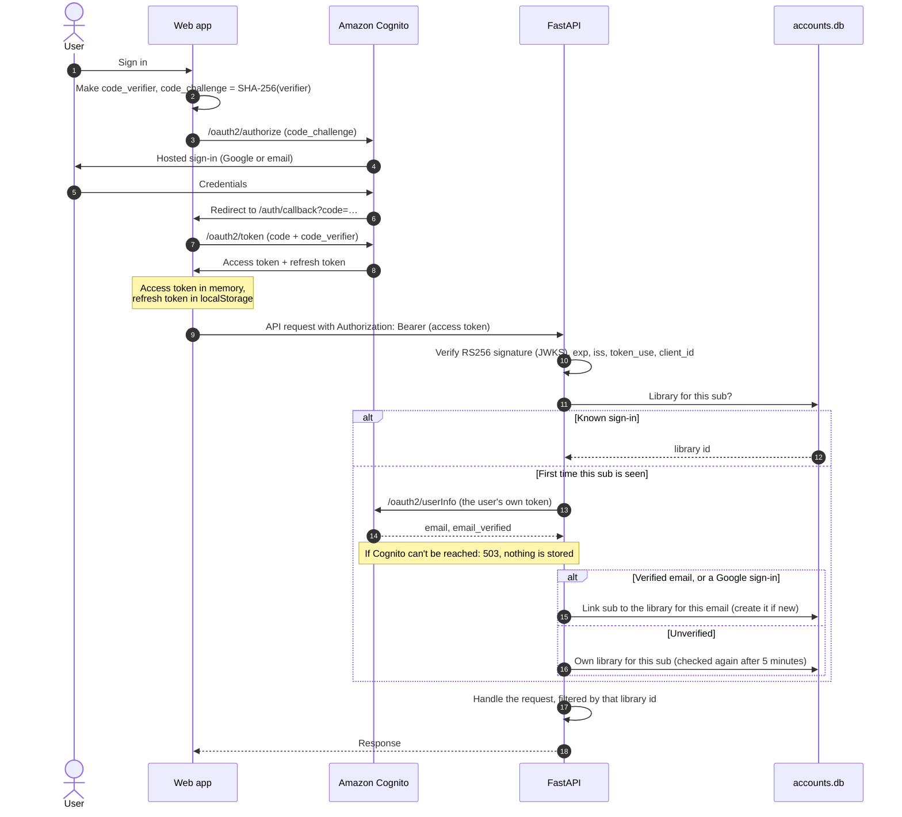

# Security

MemoryLane is multi-user, so the main security property is **isolation**: nobody can read, search, summarise or delete another person's pages.

## Authentication

- Sign-in is handled by **Amazon Cognito** (Google, or email and password). MemoryLane never handles passwords.
- The web app and the extension use the **authorization-code flow with PKCE** and a public client (no client secret).
- Every API request except `GET /health` needs `Authorization: Bearer <access token>`.

## Token verification

`backend/auth.py` verifies each access token:

- **RS256 signature** against the user pool's JWKS (keys cached for an hour)
- `exp` (not expired)
- `iss` (this user pool)
- `token_use == "access"` (ID tokens are refused)
- `client_id` (this app client)

The user id is the library of the token's `sub`. **No endpoint accepts a user id from the client.**

Cognito gives a Google sign-in and an email + password sign-in different `sub`s, even for the same address. `backend/accounts.py` links them:

- The first time a `sub` is seen, the backend calls Cognito's `/oauth2/userInfo` with that user's own access token, so the email can't be faked by the browser.
- The email links only if it's verified: `email_verified` is `"true"` (the string Cognito sends; `"false"` doesn't count), or the sign-in came through Google. The first verified sign-in for an address gives the library its id; later ones for the same address use it.
- An unverified sign-in keeps its own library and claims nothing. It's checked again after 5 minutes, so verifying later still links.
- If Cognito can't be reached for a `sub` seen for the first time, the request fails with `503`, so pages never land in a library they don't belong to. Known sign-ins are answered from the database without calling Cognito.
- The links are stored in SQLite (`ACCOUNTS_DB`, the `accounts` volume in Docker). **Delete all** removes them.

### Sign-in and the first request

The extension follows the same flow through `chrome.identity.launchWebAuthFlow`, and keeps its tokens in `chrome.storage.local`.

## Data isolation

- `SolrClient` adds `{!term f=user_id}` to every query, scan, KNN search and delete, and raises an error if the id is missing or malformed. Isolation doesn't depend on each endpoint remembering to filter.
- KNN searches use the filter as a **pre-filter**, so other users' vectors are never candidates.
- `page_id` includes the user id in its hash, so two users' copies of a page never collide.
- A request for someone else's page gets `404`, the same as a missing page, so page ids can't be probed.
- `tests/test_isolation.py` checks this with two users: search, summaries, deletes, status, library, delete-all and related pages, plus a check that every Solr request carries the user filter.

## Network

- Only **Caddy** (ports 80 and 443) is public. HTTP redirects to HTTPS, with HSTS.
- Solr is bound to `127.0.0.1`. The backend has no published port and is reachable only through Caddy.

## Browser

- The access token lives in memory only. The refresh token is in `localStorage`, so a reload stays signed in.
- Because a script on the page could read that refresh token, the app **never renders user-supplied HTML** (Svelte's `{@html}` is not used), and Caddy sends a strict **Content Security Policy**: scripts from the site only, connections only to the site and Cognito, no framing, no plugins.
- The extension stores its tokens in `chrome.storage.local`, which web pages can't read.

## Abuse limits

- Rate limits per user (or per IP before sign-in), from 5/minute for delete-all to 120/minute for light reads.
- At most 5,000 saved pages per account (`MAX_PAGES_PER_USER`).
- Request size limits: URL 2,048 characters, title 500, text 500 KB, HTML 3 MB, query 500 characters.
- The backend never fetches a URL supplied by the client. YouTube requests are built from a validated video id.

## Secrets

`.env` (Cognito ids, Gemini key) and the extension's private signing key are kept out of git.
