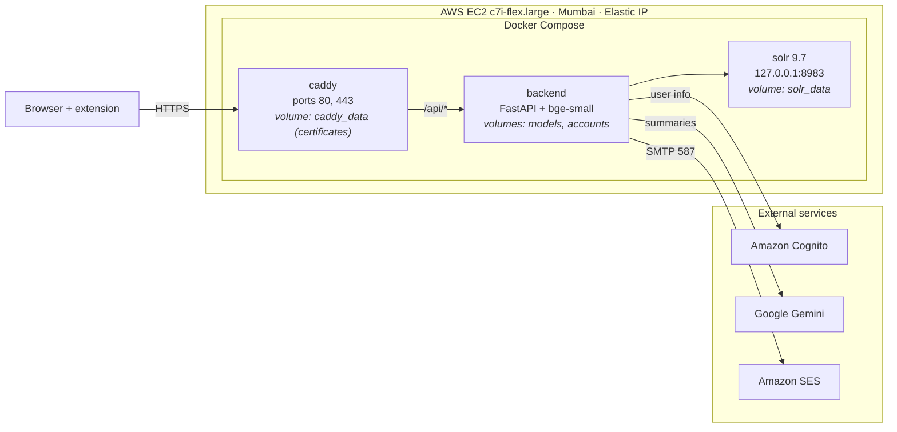

# Deployment

MemoryLane runs on one machine with Docker Compose. The live site is an AWS EC2 `c7i-flex.large` (2 vCPU, 4 GB RAM, plus 2 GB swap) in the Mumbai region, with an Elastic IP and the domain `memorylane.site`.

## Services

| Service | What it does | Reachable from |
| --- | --- | --- |
| `solr` | Solr 9.7 with a 1 GB heap; data in a named volume | `127.0.0.1:8983` on the server only |
| `backend` | FastAPI and the embedding model (cached in the `models` volume); which sign-ins share a library in the `accounts` volume | Caddy only; no published port |
| `caddy` | Gets HTTPS certificates, serves the built web app and the extension zip, proxies `/api/*` to the backend, redirects `www.` | Ports 80 and 443 |



Only ports 80 and 443 are open to the internet. The backend has no published port, and Solr listens on the server's localhost only. The `accounts` volume holds `accounts.db` and `reports.db`.

The Caddy image builds the web app (`npm run build`) and zips the `extension/` folder, so `https://memorylane.site/memorylane-extension.zip` always matches the code being deployed.

## First deployment

From `code/src` on the server:

```bash
cp .env.example .env              # fill in Cognito, Gemini, DOMAIN
docker compose up -d solr
docker compose exec solr solr create -c memorylane_v2 -d _default
CORE_NAME=memorylane_v2 bash scripts/setup_solr.sh
docker compose up -d --build
curl -s https://<your-domain>/api/health
```

Before that, point the domain's `A` records (with and without `www.`) at the server and open ports 80 and 443. Ports 8000 and 8983 should stay closed.

The repository's `code/src/deploy/README.md` is the full step-by-step guide. It covers swap, moving data from an older core, the reboot test, and backups with EBS snapshots.

## Updating

```bash
cd code/src
git pull origin master
docker compose up -d --build
docker compose logs -f backend
```

Container logs are capped at 3 files of 10 MB per service. They contain page ids, not the URLs people save or what they search for: query strings are dropped from the access log, and the backend's own requests to Solr and Cognito aren't logged.

### Schema changes

Solr's automatic field creation is turned off, so a new field has to exist **before** the backend that writes it is deployed:

| Field | Added by | Then |
| --- | --- | --- |
| `description` | `scripts/add_description_field.sh` | Pages get one the next time they're saved |
| `page_embedding` | `scripts/add_page_embedding_field.sh` | `python -m scripts.backfill_page_vectors` gives older pages a page vector (resumable) |

!!! warning
    Never run `docker compose down -v`. It deletes Solr's data, the downloaded models and Caddy's certificates.

## Moving pages between cores

`scripts/reindex.py` copies pages from one core into another under a given user id, re-cleaning, re-chunking and re-embedding them. The source core is never modified.

```bash
docker compose exec backend python -m scripts.reindex \
  --source-core memorylane --target-core memorylane_v2 --user-id <cognito-sub> [--dry-run]
```

## Publishing the documentation

This site is built with MkDocs and Material, and published to GitHub Pages by hand from the repository root:

```bash
pip install mkdocs==1.6.1 mkdocs-material==9.7.7 pymdown-extensions==11.0.1 model2vec==0.10.0
mkdocs gh-deploy --strict
```

`.github/workflows/mkdocs.yml` runs the same build (`mkdocs build --strict`) on every push that changes the docs, so broken links fail the check, but it doesn't publish.

### Meaning-based search

Besides the theme's keyword search, the search box finds sections by meaning. After each build, `hooks/semantic_search.py` embeds every section of the docs with **Model2Vec potion-base-8M**, a small *static* embedding model distilled from bge-base-en-v1.5, and writes the files to `site/assets/semantic/`: the model's word pieces and an int8 vector table (about 8 MB in all), and every section's vector. The file names carry a content hash, so browsers re-download them only when they change.

In the browser (`docs/assets/javascripts/semantic-*.js`), nothing loads with the page. The first time the search box gets focus, the files are fetched. Each query is then split into word pieces exactly as the build did (BERT WordPiece), its vector is the average of their vectors, and it's compared with every section in a few milliseconds; no neural network runs. The best sections are fused with the keyword results by Reciprocal Rank Fusion, as MemoryLane fuses BM25 and vector search, and shown above them. Meaning-only matches with a cosine similarity below 0.35 are left out.

`code/src/frontend/src/lib/docsSearch.test.js` checks that the browser's tokenizer and vectors match the build's, using a fixture made from the real model.
