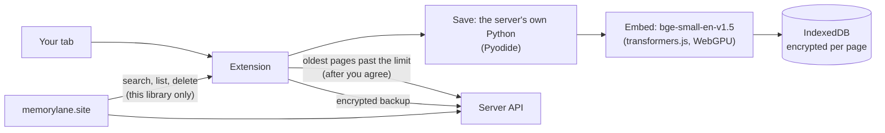

# Pages on Your Device

By default the extension keeps saved pages **on your device**: it saves, stores and searches them in your browser, and the server never receives them. The server version is still there, as a choice and as the fallback for large libraries ([ADR 0012](../decisions/0012-local-first-storage.md)).

The search design is the same in both places, down to the scores: a page saved on the device and the same page saved on the server rank identically.

## Saving

1. The extension reads the page from your tab, as it always has.
2. **The server's code cleans and chunks it, in the browser.** Pyodide (Python compiled to WebAssembly) runs `backend/ingest.py` and the modules it uses, with trafilatura, bundled into the extension ([ADR 0015](../decisions/0015-server-code-in-the-browser.md)). So the text, chunks, title and description are exactly what the server would store.
3. **The same model embeds the chunks**: bge-small-en-v1.5 at full precision, run by transformers.js, on WebGPU when the browser has it. Its vectors match the server's to about 1e-7. The model's weights (~130 MB) are downloaded once from the MemoryLane site and cached.
4. **The page is stored encrypted**: one record per page in IndexedDB, encrypted with your account's device key ([ADR 0016](../decisions/0016-encrypt-local-pages-and-backups.md)). The record holds the text, keyword statistics and vectors, so opening the store needs no re-analysis.

A long page (67 chunks of Wikipedia) takes about 5 seconds to save in Chromium; most pages take under a second.

## Searching

`extension/engine/` reproduces the server's search step for step:

| Server | Device |
| --- | --- |
| Solr `text_en` analysis | `analyzer.js`, `porter.js`: the same tokenizer, stop words, possessives, protected words, Porter stemmer and query synonyms |
| edismax BM25 (`title^2 text`, phrase boosts `text^2 title^3`) | `bm25.js`: the same clauses and Lucene 9's BM25, including its one-byte document lengths and float maths |
| Exact vector scoring ([ADR 0013](../decisions/0013-exact-vector-search.md)) | `local_index.js`: an int8 scan, then exact rescoring of the best candidates |
| `backend/retrieval.py`, `query_intent.py`, `snippets.py` | `retrieval.js`, `query_intent.js`, `snippets.js`: the same fusion (RRF, k = 60), page grouping, relevance floor (0.55), keyword coverage (75%), site/time/URL hints and snippets |
| `backend/config.py` | `settings.js`, refreshed from `GET /api/search-settings`, so a setting changed on the server applies locally too |

A search over a few thousand pages takes about 50 to 120 ms.

### Checked against the server

The parity checks in `code/src/evaluation/parity/` run both engines on the same data:

| Check | Result |
| --- | --- |
| Text analysis of 2,006 SciFact titles and abstracts, plus awkward strings (Unicode, URLs, CJK, Thai, emoji) | identical tokens, positions and stems to Solr's |
| Keyword search, 119 queries (claims, operators, quotes, wildcards) | same top 50, same order, scores equal to 1e-5 |
| Full hybrid search, 117 queries (claims, site words, time phrases, URLs) | same pages, order and snippets |
| Saving 10 real pages (Wikipedia, MDN, BBC, GitHub, ...) | identical chunks, titles, descriptions and refusals |

One difference remains by design: Solr counts how rare a word is across **all** users' pages in its one index, while the device counts across your pages only. It can reorder close keyword ties when your pages are split between the two places.

## Both places at once

A page lives whole in one place. When some of your pages are on the server (by choice, or after moving past the size limit), the website searches both: it asks the extension for this device's results, the server for its own, and fuses the two ranked lists with RRF. It waits up to 1.5 seconds for the server once the device has answered.

The website asks the extension only through Chrome's site-to-extension messaging, which only memorylane.site may use, and the extension answers only for the library the site is signed in to.

## The size limit

**Options** sets a size limit for pages on the device (default 100 MB) and what happens past it: ask first, move the oldest pages to the server, or keep everything on the device. Moving a page sends its chunks exactly as stored (`POST /memory/transfer`), so it ranks the same on the server.

## Encrypted backups

The extension can back up the device's pages, encrypted with a **recovery key** only you have. The server stores the backup and can't open it ([ADR 0016](../decisions/0016-encrypt-local-pages-and-backups.md)). See [Storage and Backups](../user-guide/storage.md).
