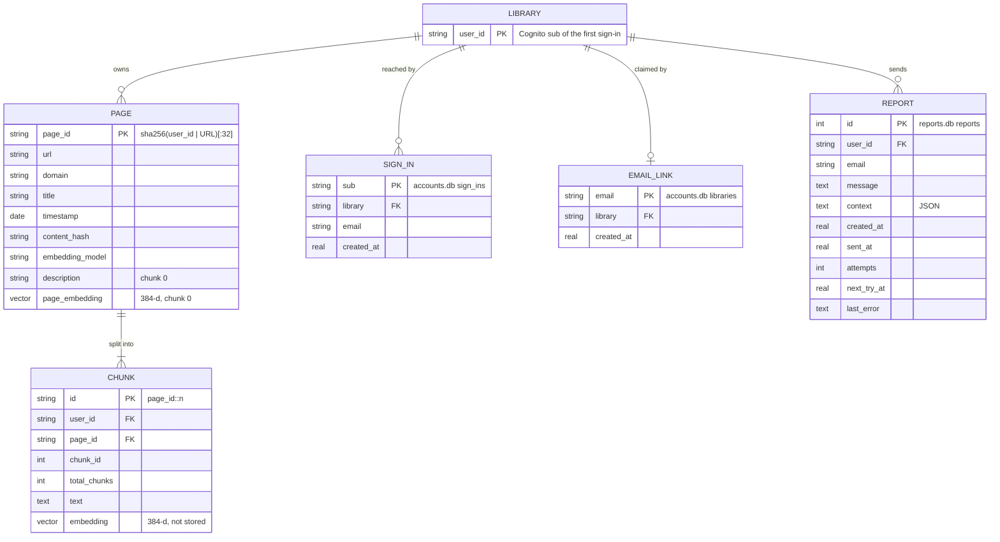

# Storage

MemoryLane stores everything in **Apache Solr 9.7**, in a standalone core named `memorylane_v2`.

## Why Solr?

One system covers what MemoryLane needs:

- Full-text search with BM25, English stemming and stopwords (`text_en`)
- Dense-vector search (`DenseVectorField`, cosine), scored exactly over one user's pages ([ADR 0013](../decisions/0013-exact-vector-search.md))
- Updates and deletes by query, and cursor-based scans

## Document model

Each chunk is one Solr document. Chunk 0 also carries the page-level fields.

| Field | Type | Purpose |
| --- | --- | --- |
| `id` | string | `{page_id}::{chunk_index}` |
| `user_id` | string | Owner: the Cognito `sub` of the first sign-in for that email; every query filters on it |
| `page_id` | string | Groups a page's chunks |
| `url` | string | Normalised URL |
| `domain` | string | Site |
| `title` | `text_en` | Page title (boosted ×2 in search) |
| `text` | `text_en` | Chunk text |
| `chunk_id`, `total_chunks` | int | Position and count |
| `timestamp` | date | When the page was saved |
| `content_hash` | string | Skips re-processing unchanged pages |
| `embedding_model` | string | Re-embeds when the model changes |
| `description` | string, stored only | Snippet fallback |
| `embedding` | vector, 384-d, not stored | Chunk vector for KNN |
| `page_embedding` | vector, 384-d, stored (chunk 0) | Page vector for related pages |

`scripts/setup_solr.sh` is the single source of truth for this schema. Automatic field creation is turned off, so a document with an unknown field is rejected instead of silently adding a guessed field.

## Data model

Solr holds the pages; two small SQLite files next to it hold sign-in links and problem reports. Solr isn't relational, so the diagram shows the logical model: a library is the `user_id` that every chunk, link and report carries.

`PAGE` isn't a separate document: its fields live on the page's chunks (chunk 0 carries the page-level ones), as the table above shows.

## Writes

- Saves use `commitWithin` (1 s) rather than explicit commits.
- Deleting one page uses a soft commit instead, so a list fetched straight afterwards (the website reloading while the delete is sent) no longer shows it.
- A re-saved page is upserted chunk by chunk, then any leftover higher-numbered chunks are deleted, so there are never duplicates.
- Deleting a page deletes by `user_id` **and** `page_id`; deleting an account's data deletes by `user_id`.

## Isolation

Every read, search, delete and scan in `backend/solr_client.py` adds a `user_id` filter, and refuses to run if the user id is missing or malformed. Vector searches pass the filter as a KNN pre-filter, so other users' vectors are never considered.

## Pages kept on your device

With the extension, pages are stored on your device by default, not in Solr: one encrypted record per page in the browser's IndexedDB, holding the text, keyword statistics and vectors. See [Pages on Your Device](local-search.md).
