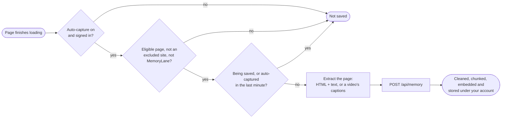

# Saving Pages

Pages get into MemoryLane through the Chrome extension, in one of two ways.

## Remember this page

Open the extension on any page and press **Remember this page**.

- The popup confirms **Saved just now**, with an **Undo** button.
- If the page is already in your library, the popup says so and offers **Remove**.
- Saving the same page again updates it. If its text hasn't changed, nothing is re-processed.
- A page needs at least **50 readable words**. Pages with less (an empty app screen, a login form) are refused with a message.

`Alt+Shift+M` opens the MemoryLane website from anywhere in Chrome.

## Automatic capture

Automatic capture saves eligible pages when they finish loading. It is **off by default**: you turn it on in the extension popup, and the first time you do, the popup explains what it does before enabling it.

It only runs while you're signed in. Signing out stops it.

### What automatic capture skips

- Social-media sites
- Banks and payment services
- Email: Gmail, Outlook, Yahoo Mail, Proton Mail, iCloud Mail and other webmail (including `mail.` and `webmail.` sites, and `/owa/` and `/webmail/` pages)
- Login, sign-up, account, password, checkout, billing, payment and wallet pages
- Browser-internal pages (`chrome://`, `chrome-extension://`, `file://`, ...)
- Search-engine result pages
- Utility pages such as error, privacy, terms, cookie and sitemap pages
- Files: PDF, images, audio and video, archives, CSV, JSON, XML
- Pages with very little text
- YouTube pages that aren't a video, and videos longer than two hours

### Excluded sites

From the popup you can exclude the current site with one click. The extension's options page lists every excluded site, and you can add or remove them there. Excluded sites are never captured automatically, but you can still save a page from them by hand.

Manual saving skips the automatic-capture filters: if you press **Remember this page**, the page is saved (as long as it has enough text). The button is there whether or not automatic capture is on, so you can still save a page it skipped, such as a Reddit thread or a long video.

### When a capture fails

If an automatic save fails (no connection, or you were signed out), reloading the page tries again. A page isn't sent twice within a minute, and the extension checks the tab is still on the same page when it reads it, so text from one page is never saved under another's address.
