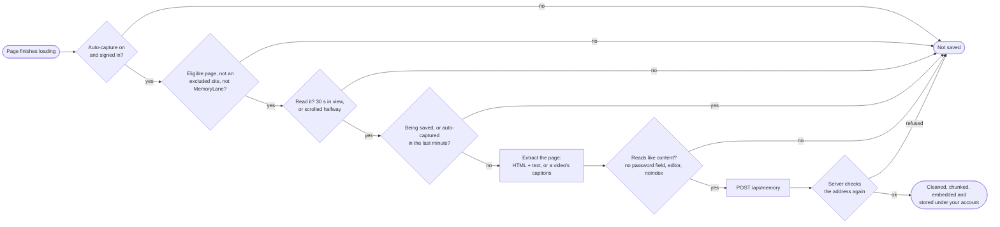

# Saving Pages

Pages get into MemoryLane through the Chrome extension, in one of two ways.

## Remember this page

Open the extension on any page and press **Remember this page**.

- The popup confirms **Saved just now**, with an **Undo** button.
- If the page is already in your library, the popup says so and offers **Remove**.
- Saving the same page again updates it. If its text hasn't changed, nothing is re-processed.
- A page needs at least **50 readable words**. Pages with less (an empty app screen, a login form) are refused with a message.

`Alt+Shift+M` opens the MemoryLane website from anywhere in Chrome.

## Automatic capture

Automatic capture saves pages you actually read, as long as they look like something worth keeping: an article, documentation, a post or a video. It is **off by default**: you turn it on in the extension popup, and the first time you do, the popup explains what it does before enabling it.

It only runs while you're signed in. Signing out stops it.

Instead of trying to list every site you wouldn't want saved, it only keeps pages that pass three tests:

1. **The address isn't private**: not email, banking, social media, a private app, a local address, or an account area (lists below).
2. **You read it**: the page was on screen for 30 seconds, or you scrolled at least halfway down a long page. Pages you bounce off (wrong clicks, redirects, login walls) are never saved.
3. **It reads like content**: at least 150 words of readable text that isn't mostly links, and no sign of being a private screen: no visible password field, no compose box or document editor, not mostly a form, and not marked `noindex` (the tag most logged-in pages carry). Videos pass on their page type.

### What automatic capture skips

- Social-media sites
- Banks and payment services
- Email: Gmail, Outlook, Yahoo Mail, Proton Mail, iCloud Mail and other webmail (including `mail.` and `webmail.` sites, and `/owa/` and `/webmail/` pages)
- Private apps: Google Docs, Drive, Calendar and Classroom, Microsoft Teams and OneDrive, Notion, Slack, WhatsApp Web, Telegram Web, Figma, Trello, Dropbox, iCloud, chat assistants, cloud consoles, and college systems (Canvas, Blackboard, and `moodle.`, `lms.`, `portal.` and similar sites)
- Local and intranet addresses: `localhost`, `192.168.x.x`, `10.x.x.x`, `.local`, `.internal`
- Account areas of any site: dashboard, admin, settings, profile, inbox, messages, notifications, cart and orders pages
- Links that carry a secret, such as `?token=`, `?code=` or `?session=`
- Login, sign-up, account, password, checkout, billing, payment and wallet pages
- Browser-internal pages (`chrome://`, `chrome-extension://`, `file://`, ...)
- Search-engine result pages
- Utility pages such as error, privacy, terms, cookie and sitemap pages
- Files: PDF, images, audio and video, archives, CSV, JSON, XML
- Pages that don't read like content (see the three tests above)
- YouTube pages that aren't a video, and videos longer than two hours

The server checks the address rules (and `noindex`) again for every automatic save, so even an outdated extension can't store these pages.

### Auto-saved today

The popup lists the last few pages automatic capture saved in the past day. Each has **Remove**, which deletes it, and **Never this site**, which deletes it and excludes its site, so a page you didn't want is gone in one click. Pages you've since deleted on the website drop off the list when you open the popup.

Automatic capture never touches a page that's already in your library: it keeps the date you saved it, and it doesn't appear in this list. To update a saved page, press **Remember this page**.

### Excluded sites

From the popup you can exclude the current site with one click. The extension's options page lists every excluded site, and you can add or remove them there. Excluded sites are never captured automatically, but you can still save a page from them by hand.

Manual saving skips the automatic-capture filters: if you press **Remember this page**, the page is saved (as long as it has enough text). The button is there whether or not automatic capture is on, so you can still save a page it skipped, such as a Reddit thread or a long video.

### When a capture fails

If an automatic save fails (no connection, or you were signed out), reloading the page tries again. A page isn't sent twice within a minute, and the extension checks the tab is still on the same page when it reads it, so text from one page is never saved under another's address.
