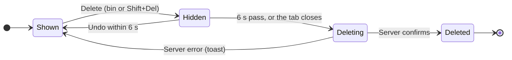

# Library and Account

## Recently saved

The home page lists your most recently saved pages under the search box. **View all** opens the full library.

## All saved pages

The library (`/library`) lists every page you saved, newest first, 20 at a time with **Load more**. Each row shows the title, site, letter tile and when you saved it.

## Deleting a page

Use the bin icon on a row in the library, home page or search results (or `Shift` + `Del` on a selected search result).

- The page disappears at once and a toast offers **Undo** for 6 seconds.
- After that, it's deleted from the server.
- If you close or reload the tab during those 6 seconds, the delete is sent straight away, and a reloaded page keeps it hidden.
- If the server can't delete it, the page comes back with an error message.

## Account menu

The circle at the top right shows your initial and opens the account menu:

| Item | What it does |
| --- | --- |
| **All saved pages** | Opens the library |
| **Get the extension** | Opens the extension page (hidden once the extension is installed) |
| **Delete all my data** | Deletes every page you saved, after a confirmation |
| **Report a problem** | Sends a message to the maintainer; the form shows everything sent with it ([what's included](../privacy.md#problem-reports)) |
| **Sign out** | Signs out of the website |

Signing out of the website doesn't sign out the extension. Sign out of it from its own popup.
